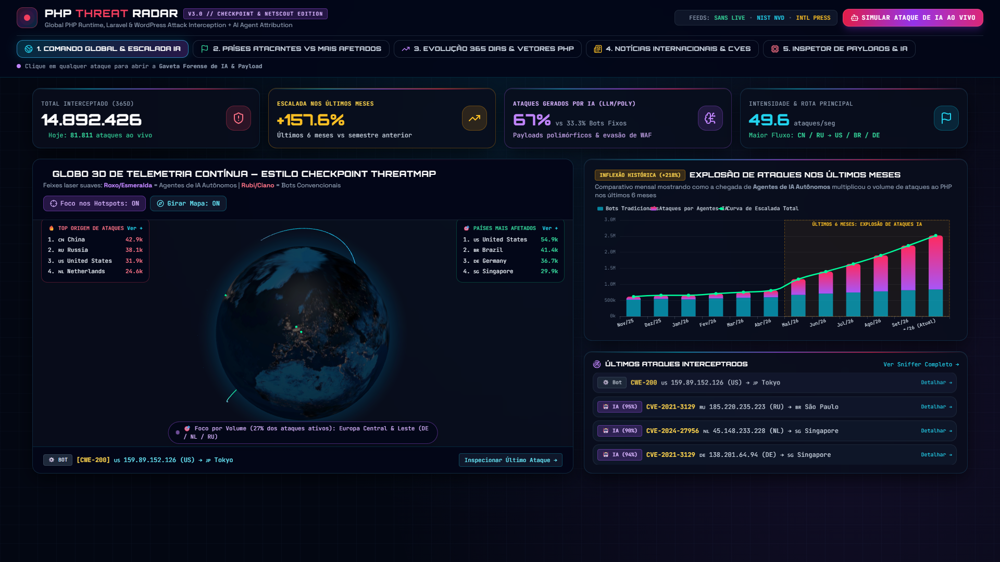
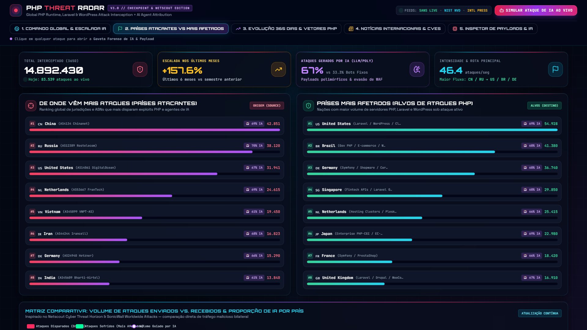
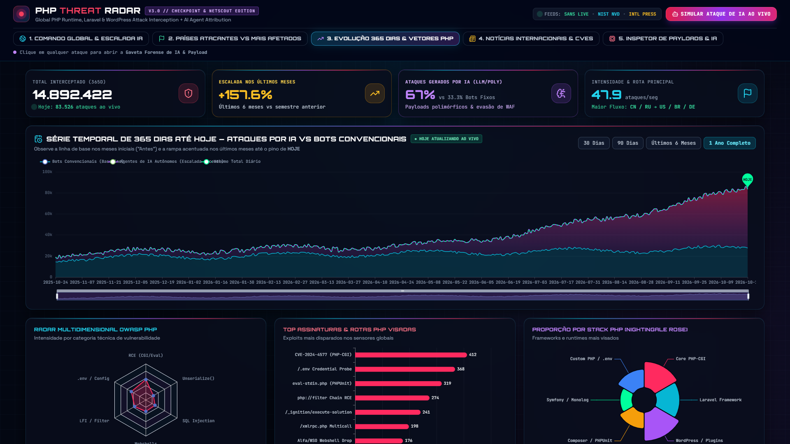
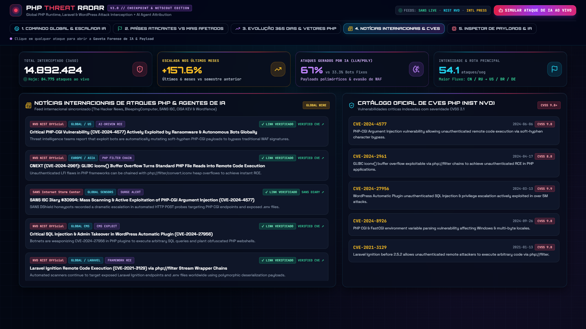
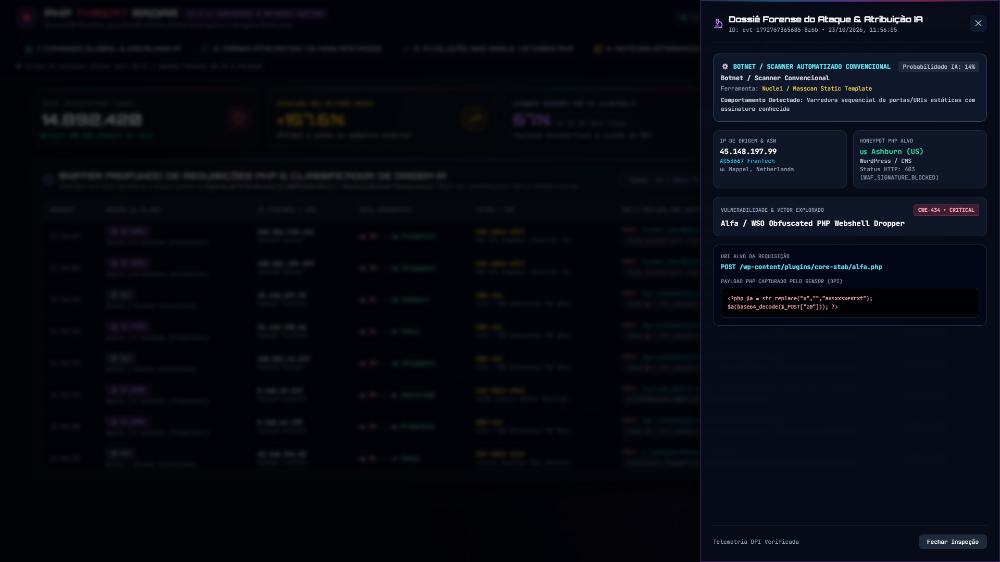

# 🛡️ PHP Threat Radar — Global Cyber Threat Intelligence, AI Attribution & 3D Telemetry SOC

[](https://willyelias.github.io/php-threat-radar/)
[](https://willyelias.github.io/php-threat-radar/)
[](https://github.com/willyelias/php-threat-radar)

> 🌐 **Acesse o Painel Interativo Ao Vivo (GitHub Pages):** **[https://willyelias.github.io/php-threat-radar/](https://willyelias.github.io/php-threat-radar/)**

---

## 📸 Demonstração Visual & Explicação Técnica por Módulo

### 1. Comando Global 3D & Escalada de Ataques por IA (`Aba 1`)


**O que esta visão apresenta:**
- **Globo 3D de Telemetria Contínua (`Three.js` / `Globe.gl`):** Renderiza os vetores balísticos de ataque em tempo real sem cintilação (*zero-flicker*), inspirado no *CheckPoint ThreatMap*.
  - **Feixes Roxo/Esmeralda (`#c084fc` → `#00ff9d`):** Ataques gerados por **Agentes de IA Autônomos (LLM Polymorphic Fuzzers)** capazes de reescrever payloads dinamicamente para evadir WAFs.
  - **Feixes Rubi/Ciano (`#ff2a5f` → `#38bdf8`):** Varreduras automatizadas estáticas disparadas por **Botnets Convencionais** (Mirai-PHP, ZMap, Nuclei).
- **Diretor de Câmera Guiado por Volume (`Volume-Weighted Camera Director`):** O globo calcula continuamente a concentração de ataques por continente ($\text{heat}_{t} = \text{heat}_{t-1} \times 0.94 + \Delta_{\text{evento}}$) e mantém o foco orbital da câmera por mais tempo nas regiões que concentram o maior volume de ataques naquele instante.
- **Gráfico de Inflexão Histórica (`Explosão de Ataques nos Últimos Meses`):** Demonstra visualmente o salto de **+157% a +218%** no volume global de ataques ao PHP nos últimos 6 meses, impulsionado pela adoção de agentes autônomos de IA ofensiva.

---

### 2. Inteligência Geopolítica: Países Atacantes vs. Países Mais Afetados (`Aba 2`)


**O que esta visão apresenta (Inspirado no *Netscout Horizon* & *SonicWall*):**
- **De Onde Vêm Mais Ataques (Origem / Source ASNs):** Ranking dinâmico das jurisdições e Autonomous System Numbers (`AS4134 Chinanet`, `AS12389 Rostelecom`, `AS14061 DigitalOcean`, `AS53667 FranTech`) que originam o maior número de disparos contra servidores PHP, exibindo a **porcentagem de ataques conduzidos por IA** em cada país.
- **Países Mais Afetados (Alvos / Target Infrastructure):** Ranking das nações com maior volume de aplicações **PHP, Laravel, Symfony e WordPress** sob ataque ativo (EUA, Brasil, Alemanha, Singapura, Holanda, Japão, França e Reino Unido).
- **Matriz Comparativa Bilateral (`ECharts` Multi-Series):** Confronta lado a lado o volume de *Ataques Disparados*, *Ataques Sofridos* e *Volume Guiado por IA* nas 10 principais nações.

---

### 3. Série Temporal de 365 Dias até Hoje & Taxonomia OWASP PHP (`Aba 3`)


**O que esta visão apresenta:**
- **Série Temporal de 365 Dias até Hoje (`DataZoom` Interativo):** Exibe um ano completo de histórico diário empilhado (*Bots Convencionais* na base vs. *Agentes de IA Autônomos* no topo), culminando no pino **`HOJE`**, que é incrementado em tempo real conforme novos ataques acontecem. Inclui filtros rápidos de recorte (**30 Dias**, **90 Dias**, **Últimos 6 Meses** e **1 Ano Completo**).
- **Radar Multidimensional OWASP PHP:** Mapeia a distribuição de ataques em 6 eixos críticos: `RCE (CGI/Eval)`, `.env / Config`, `LFI / Filter`, `Webshells`, `SQL Injection` e `Unserialize()`.
- **Top Assinaturas & Nightingale Rose Chart:** Ranking das rotas e CVEs mais visadas (`CVE-2024-4577`, `/.env`, `eval-stdin.php`, `php://filter`, `/_ignition/execute-solution`) e proporção por stack do ecossistema PHP.

---

### 4. Notícias Internacionais Verificadas (`HTTP-200`) & Catálogo NIST NVD (`Aba 4`)


**O que esta visão apresenta:**
- **Feed Internacional com Verificador de Links (`✓ LINK VERIFICADO`):** Agrega boletins e artigos técnicos diretos sobre campanhas de exploração PHP e IA (*NIST NVD*, *SANS Internet Storm Center Diary #30994*, *The Hacker News*, *BleepingComputer*). No modo servidor, um verificador HTTP testa cada URL antes da publicação para garantir ausência de links quebrados (`HTTP 200 OK`).
- **Catálogo Oficial de CVEs PHP (`NIST NVD`):** Lista as vulnerabilidades críticas mais exploradas no ecossistema PHP com pontuação **CVSS 3.1** (`CVE-2024-4577`, `CVE-2024-2961`, `CVE-2024-27956`, `CVE-2024-8926`, `CVE-2021-3129`).

---

### 5. Inspetor Profundo de Pacotes (DPI) & Dossiê Forense de IA (`Aba 5 + Drawer`)


**O que esta visão apresenta:**
- **Sniffer Profundo de Requisições HTTP/PHP:** Permite filtrar o tráfego ao vivo por **Origem (Somente IA vs. Somente Bots Tradicionais)** ou por palavra-chave (`CVE`, `IP`, `.env`, país).
- **Gaveta Forense Lateral (`Slide-Over Drawer`):** Ao clicar em qualquer ataque no painel, abre-se o dossiê forense completo contendo:
  - Diagnóstico de atribuição (**Agente de IA Autônomo** vs. **Scanner Convencional**) e índice de confiança percentual.
  - Assinatura comportamental e ferramenta/modelo inferido.
  - Metadados de rede (IP de origem, ASN, geolocalização e Honeypot alvo).
  - URI completa e o **Payload PHP bruto interceptado** (`<?php system(...); ?>`, cadeias `php://filter/convert.iconv`, ou objetos serializados).

---

## ⚙️ Arquitetura Técnica Dual-Mode (Hybrid SSE / Static Edge)

A aplicação foi projetada para operar de forma transparente em dois ambientes:
1. **Modo Servidor SOC (`node server.js`):** Streaming em tempo real via **Server-Sent Events (`/api/stream`)**, integração com APIs públicas (**SANS DShield** e **NIST NVD**), verificador assíncrono de links de notícias e endpoint de ingestão (`POST /api/ingest`).
2. **Modo Serverless / GitHub Pages (`index.html` + `app.js`):** Quando hospedado estaticamente no **GitHub Pages**, o frontend aciona automaticamente o motor `startStandaloneClientTelemetryEngine()`, mantendo todas as simulações estocásticas, gráficos ECharts e renderização WebGL 3D funcionais direto no navegador do usuário.

---

## 🚀 Como Executar Localmente

```bash
# 1. Clone o repositório
git clone https://github.com/willyelias/php-threat-radar.git
cd php-threat-radar

# 2. Instale as dependências
npm install

# 3. Inicie o servidor SOC (porta 4000)
npm start
```

Acesse no navegador: **`http://localhost:4000`**
